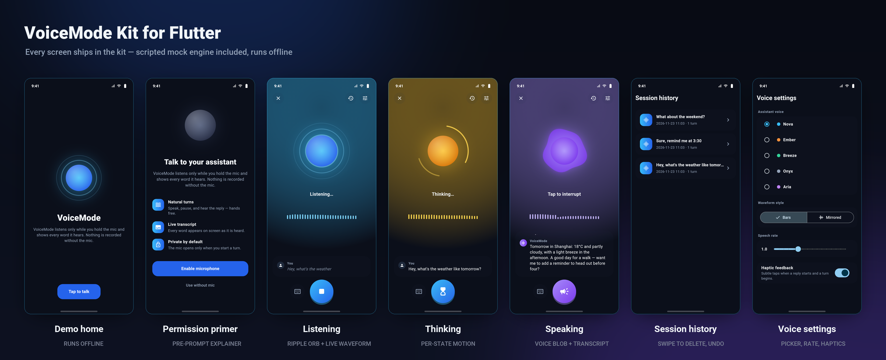
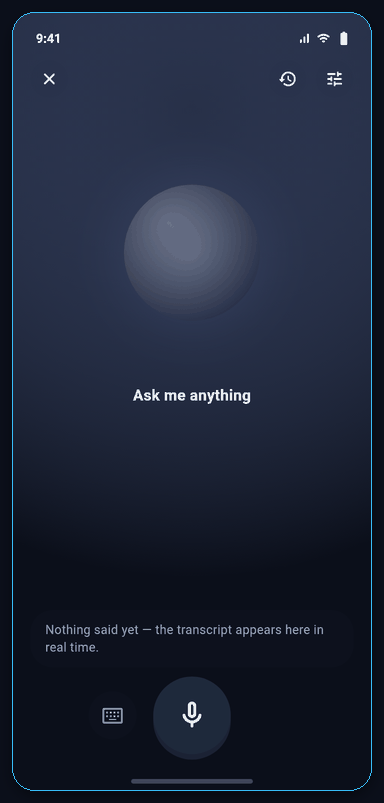
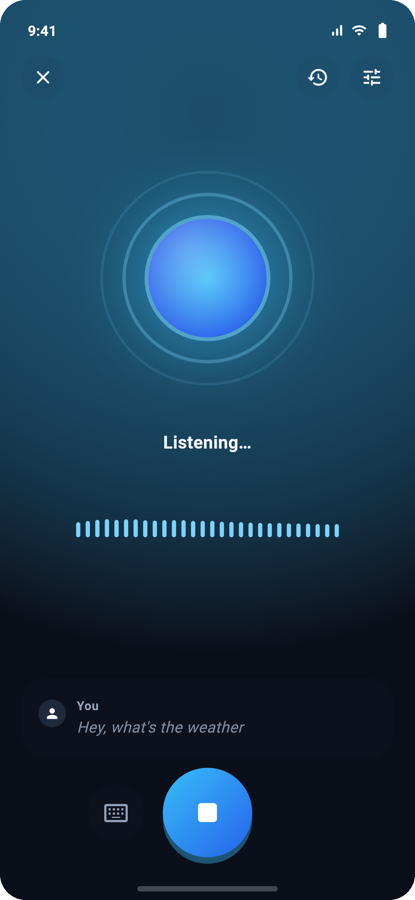
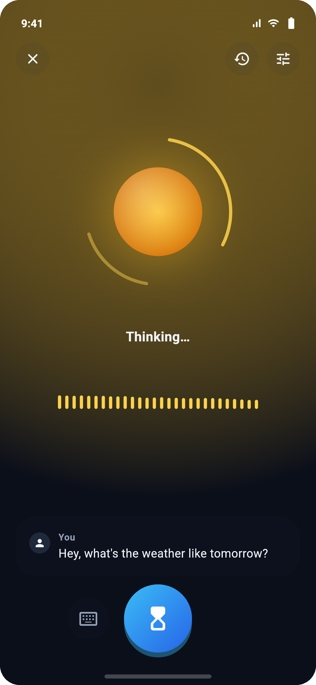
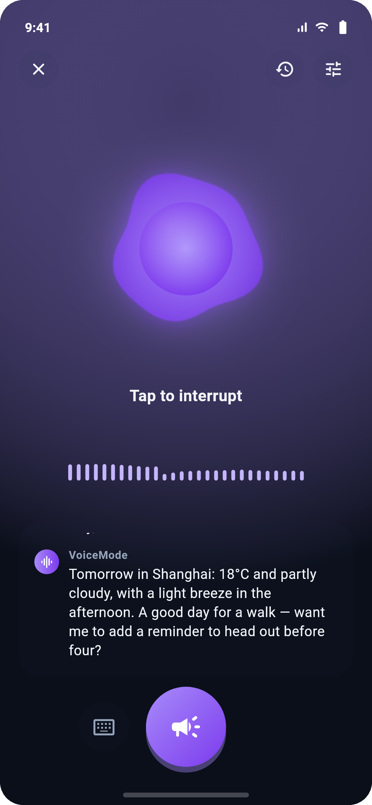
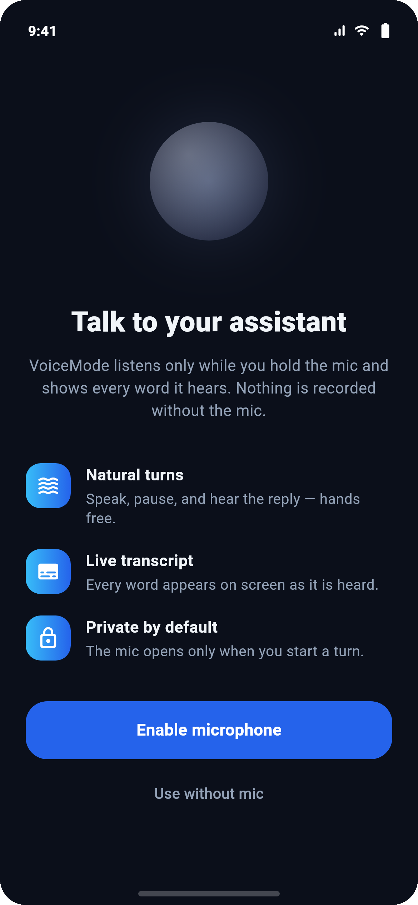
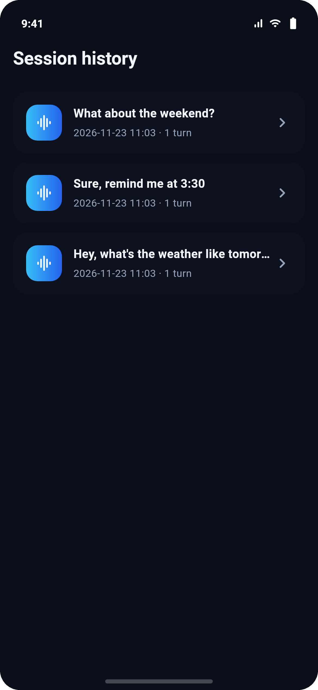
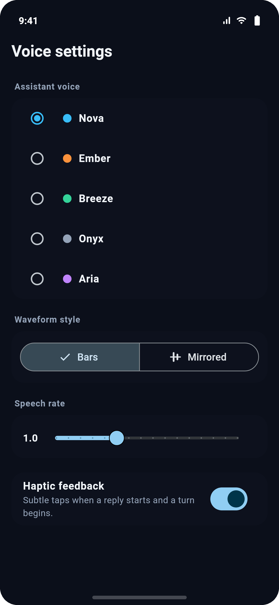

# VoiceMode Kit for Flutter 🎙️

**[EN]** The full-screen voice-assistant experience for Flutter — breathing orb, live waveform, live transcript, 5-state machine — with a swappable `VoiceEngine` adapter and a scripted mock engine. Zero third-party dependencies.

**[中文]** Flutter 全屏语音助手体验套件 —— 呼吸灯球体、实时声纹波形、实时字幕、五态状态机，附带可替换的 `VoiceEngine` 适配器与脚本化 Mock 引擎。零第三方依赖。

**[Buy on Gumroad — $2.90](https://stephencolor.gumroad.com/l/flutter-voice-mode-kit) / [Gumroad 购买直链](https://stephencolor.gumroad.com/l/flutter-voice-mode-kit)**

---

## Screens / 界面

All seven screens ship in the kit — home, permission primer, listening, thinking, speaking, history, settings.
七个界面全部随套件提供 —— 首页、权限预解释、聆听、思考、播报、历史、设置。



One voice turn, end to end (tap → listening ripples → thinking orbit → speaking blob → reply in the transcript):
一次完整语音轮次（点按 → 聆听涟漪 → 思考轨道 → 播报球体 → 字幕出回复）：



| Listening | Thinking | Speaking |
| --- | --- | --- |
|  |  |  |

| Permission primer | Session history | Voice settings |
| --- | --- | --- |
|  |  |  |

## What's in the box / 套件内容

| Piece / 模块 | What it does / 功能 |
| --- | --- |
| `BreathingOrb` | Per-state orb motion: idle breathing, listening ripples, processing orbit, speaking voice blob, error pulse / 五种状态各有独立动效 |
| `WaveformBars` | Amplitude history painter, bars + mirrored styles / 声纹历史绘制，柱状与镜像两种风格 |
| `MicButton` | Tap-to-toggle **and** hold-to-talk, pointer-cancel safe, accidental-tap rejection / 点按与按住两种模式，防误触 |
| `TranscriptView` | Partial results dimmed → final, auto-scroll that yields to user scroll / 部分识别结果淡显，自动滚动且让位于用户 |
| `VoiceController` | ChangeNotifier folding engine events into the 5-state machine / 将引擎事件折叠为五态状态机 |
| `VoiceEngine` | Abstract adapter: plug `speech_to_text`, Whisper, or any TTS without touching widgets / 抽象适配器，接入任意语音后端 |
| `MockVoiceEngine` | Scripted conversation with realistic partials & latency — runs offline / 脚本化对话，离线可跑 |
| `PermissionPrimerScreen` | Pre-prompt explainer, routes to typing fallback on denial / 权限预解释页，拒绝后转文字输入 |
| `SessionHistoryScreen` | Committed sessions, swipe-to-delete with undo / 会话历史，滑动删除可撤销 |
| `VoiceSettingsScreen` | Voice picker, speech rate, haptics, waveform style / 音色、语速、触感与波形设置 |

## Quick start / 快速开始

```bash
flutter create my_app
cd my_app
# drop the lib/ folder in, then:
flutter run   # demo app wired to MockVoiceEngine — no keys, no setup
```

```dart
import 'package:flutter_voice_mode_kit/voice_mode.dart';

final controller = VoiceController(engine: MockVoiceEngine());

Navigator.of(context).push(MaterialPageRoute(
  builder: (_) => PermissionPrimerScreen(controller: controller),
));

// Later, in production / 接入真实语音时：
final controller = VoiceController(engine: MySpeechToTextEngine());
```

## Wiring real speech / 接入真实语音

Implement the adapter once — the UI never changes:

```dart
class MySpeechToTextEngine implements VoiceEngine {
  @override
  Stream<VoiceEvent> get events => _events.stream;   // emit the typed events

  @override
  Future<void> startListening() async {
    // speech_to_text.listen(onResult: …) → emit UserPartialEvent / UserFinalEvent
    // its sound-level stream → emit VoiceLevelEvent
  }

  @override
  Future<void> stopListening() async { /* … */ }

  @override
  Future<void> sendUserText(String text) async { /* … */ }

  @override
  Future<bool> requestPermission() async { /* … */ }

  @override
  void dispose() { /* … */ }
}
```

The README of the download ships the full recipe, including a `shared_preferences` snippet for persisting `VoiceSettings`.

## Quality bar / 质量基线

- **70 tests, 8 test files — all passing**；`flutter analyze`: 0 issues
- Zero third-party dependencies / 零第三方依赖（`flutter_lints` 仅为开发依赖）
- RepaintBoundary-wrapped painters, one AnimationController per orb / 绘制隔离，单控制器驱动
- Reduced-motion support (`MediaQuery.disableAnimations`) / 跟随系统"减弱动态效果"
- Semantics labels throughout / 全量无障碍标签
- No overflow at 320 px or landscape / 320px 窄屏与横屏无溢出
- Light + dark presets via `ThemeExtension` / 明暗双主题预设

## Requirements / 环境要求

- Flutter 3.35 → 3.50+ (uses `RadioGroup` and `Color.withValues`) / Dart 3.9+
- The demo runs on every platform Flutter paints; real speech depends on the engine you plug in / 演示可在所有 Flutter 支持的平台运行；真实语音取决于所选引擎

## License / 许可

Commercial license: build and sell unlimited apps with it; don't resell the kit itself. See `LICENSE-COMMERCIAL.md` in the download.
商业许可：可无限量用于自研与客户项目并直接售卖成品；不得转售套件源码本身。详见下载包内 `LICENSE-COMMERCIAL.md`。

## Links / 链接

- Gumroad: https://stephencolor.gumroad.com/l/flutter-voice-mode-kit
- Store / 商店主页: https://stephencolor.gumroad.com
- Previous kit / 上一款: [flutter-ai-starter-kit](https://stephencolor.gumroad.com/l/flutter-ai-starter-kit)
